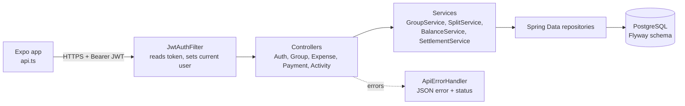
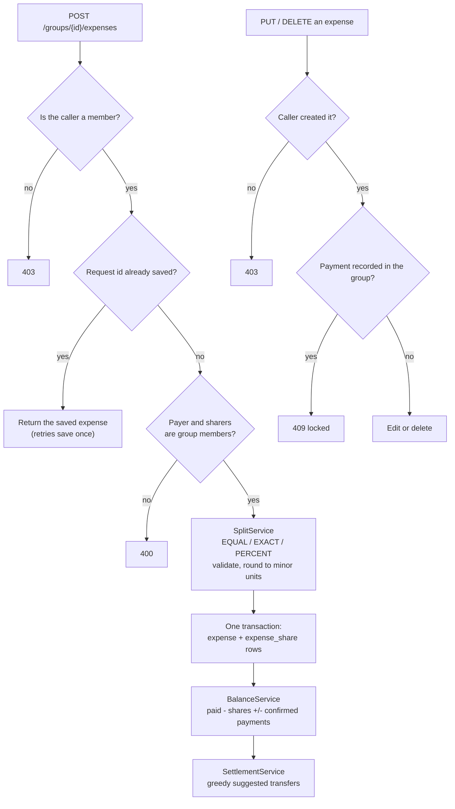
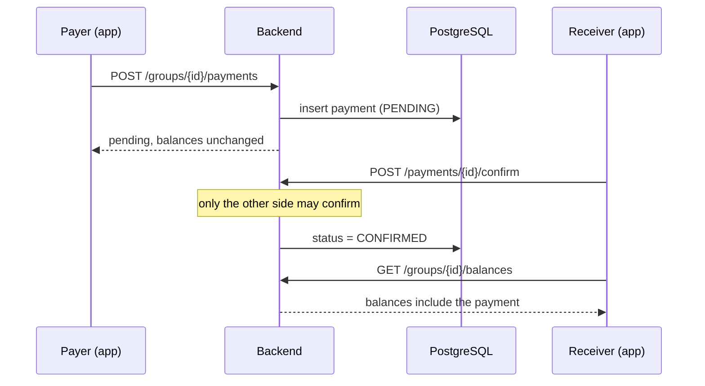
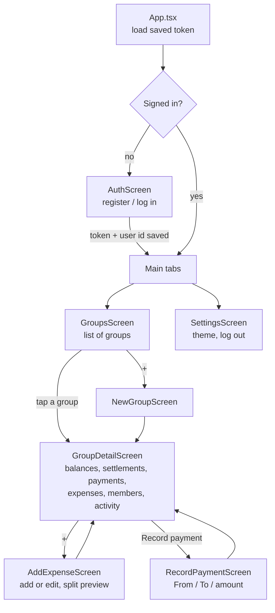
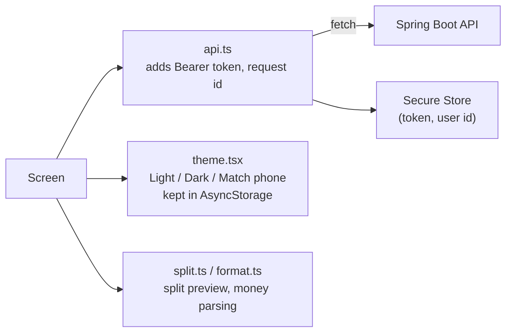

# SplitMint

<p align="center">
  <a href="demo/demo.mp4"></a>
</p>

Demo walkthrough: sign up, create a group, add a member, split expenses equally and exactly, record a payment, confirm it as the other person, and see balances return to zero. Click the animation to open the full video: [demo/demo.mp4](demo/demo.mp4).

Share expenses in a group and settle up. A React Native app (Expo, TypeScript) on a Spring Boot + PostgreSQL backend. Demo project with fake data; it records payments but never moves money.

## Tech stack

- **App** — React Native + Expo (TypeScript), React Navigation (tabs + stacks), Expo Secure Store for the auth token, AsyncStorage for the theme choice. Runs in Expo Go on a physical phone.
- **Backend** — Spring Boot 3 (Java 21), Spring Security with JWT, Spring Data JPA, Flyway migrations, PostgreSQL, Maven. Tests: JUnit 5 + MockMvc against an embedded PostgreSQL.
- **CI** — GitHub Actions runs the backend tests and the app typecheck + unit tests on every push.

## Features

- Email + password accounts with hashed passwords and expiring JWT sessions
- Groups: create, add registered members by email, leave (only when your balance is zero)
- Expenses: title, amount, date, who paid, who shares; equal, exact or percentage splits, validated server-side
- Money is integer minor units everywhere; rounding leftovers are assigned in a fixed order so shares always add up exactly (100.00 / 3 = 33.34, 33.33, 33.33)
- Per-group balances plus suggested settlements (greedy heuristic; settles everyone, not guaranteed to be the fewest transfers)
- Record a payment between two people; the other side confirms before it changes balances; expenses lock once a payment exists (correct with a reversing expense)
- Idempotent creates: every save carries a client request id, so a double tap or retry saves once
- Per-group activity feed; one fixed currency per group
- Light, Dark or Match phone theme in Settings, remembered on the device

## How to run

Backend (needs Java 21+ and Docker for the database):

```bash
cd backend
docker compose up -d          # starts PostgreSQL
cp .env.example .env          # optional; defaults work locally
./mvnw spring-boot:run        # API on http://localhost:8080
```

Windows PowerShell one-command setup and run: `scripts\run.ps1`

App (needs Node 20+ and the Expo Go app on your phone):

```bash
cd app
npm install
EXPO_PUBLIC_API_URL=http://<your-computer-ip>:8080 npx expo start
```

Scan the QR code with Expo Go. The phone and computer must be on the same network.

Tests:

```bash
cd backend && ./mvnw test          # split rules, access rules, full API flow
cd app && npm test                 # split preview + money parsing
```

## Code flow

### Backend

Every request goes through the same path: JWT filter, controller, service, repository, PostgreSQL.



Saving an expense, and what protects edits afterwards:



Recording and confirming a payment:



### Frontend





## Repo layout

| Path | What it is |
| ---- | ---------- |
| `app/` | Expo React Native app (screens, theme, API client) |
| `backend/` | Spring Boot API (domain, services, controllers, Flyway) |
| `backend/src/main/resources/db/migration/` | Database schema |
| `scripts/` | One-command setup and run |
| `demo/` | Demo video (`demo.mp4`) and preview animation |
| `.github/workflows/` | CI: backend tests, app typecheck and tests |

## Notes

- Demo project: seeded fake data, secrets come from environment variables (see `backend/.env.example`), nothing real is committed.
- A real deployment would need its own credentials and a security review; this repo is a portfolio demo, not a production service.
